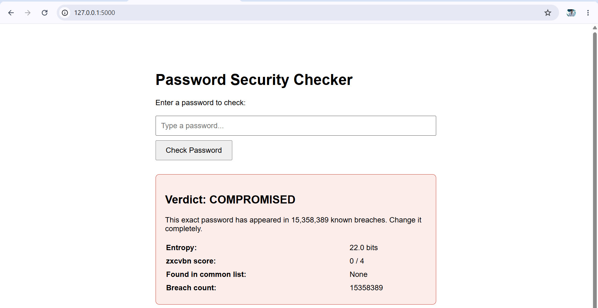
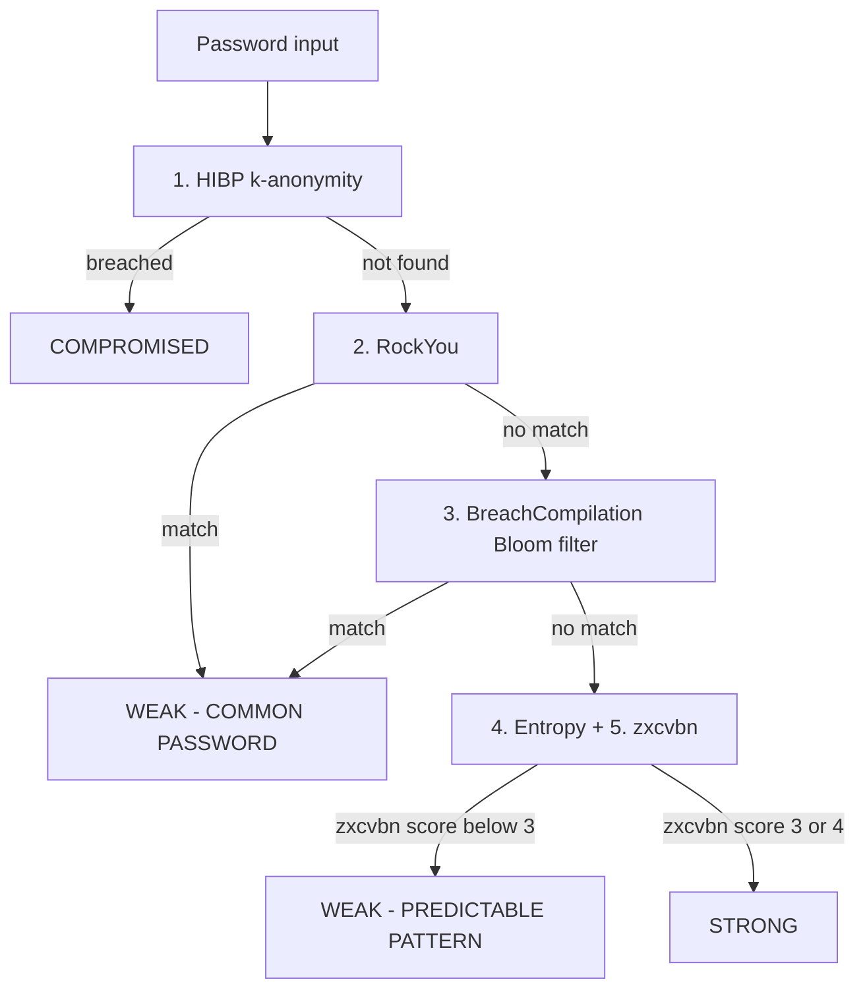

# pwbreach-tool

**A privacy-preserving password strength and breach detection tool.**
It runs five ordered checks (breach lookup, dictionary, randomness and pattern analysis) and returns **one verdict**, through a Flask web app and a JSON API that a browser extension can call.

MSc in Computing thesis project, Atlantic Technological University (ATU), Galway.
Author: Faizan Sawal · Supervisor: Dr. Owen Foley



---

## Quick start (about 5 minutes, no large datasets needed)

The real datasets are several GB and are not stored in this repository. The project therefore ships with a **small demo dataset in `data/`** and switches to it automatically when the real files are missing (the console prints `[DEMO MODE]`).

### What you need first

- **Python 3.9 or newer** (tested with 3.12). Check with `python --version` (on macOS/Linux you may need `python3`).
- **Git** (only to download the project; you can also use GitHub's green **Code → Download ZIP** button instead).
- **An internet connection** for the web app, because check 1 queries the Have I Been Pwned API.

### Step 1: Get the code

```bash
git clone https://github.com/FaizanS27/pwbreach-tool.git
cd pwbreach-tool
```

### Step 2: Create an isolated environment and install the libraries

| | Windows | macOS / Linux |
|---|---------|---------------|
| Create | `python -m venv venv` | `python3 -m venv venv` |
| Activate | `venv\Scripts\activate` | `source venv/bin/activate` |

Then, on every system:

```bash
pip install -r requirements.txt
```

### Step 3: Check that everything works

```bash
python -m unittest discover -s tests -v
```

You should see `Ran 8 tests ... OK`. These tests need no internet.

### Step 4: Start the web app

```bash
python app.py
```

Wait for the line `Server ready.`, then open **http://127.0.0.1:5000** in your browser. Stop the server with `Ctrl + C`.

### Step 5: Try some passwords

| Enter | Expected verdict | Why |
|-------|------------------|-----|
| `123456` | `COMPROMISED` | Found in Have I Been Pwned |
| `letmein` | `COMPROMISED` | Found in Have I Been Pwned (also in the demo dictionary) |
| `Tr0ub4dor-demo-9271` | `WEAK - COMMON PASSWORD` | Found only in the demo Bloom filter (a synthetic entry) |
| a long random string, e.g. `xK9#mPq2$vLw8zRt` | `STRONG` | Passes every check |

The result page is a report card: the verdict, an estimated crack time, one card per check (checks that were skipped show in grey), and, for weak passwords, a generated stronger password with a **Copy** button. A **Dark mode** button is in the top right.

Demo mode is for reviewing the logic. Only the full datasets reproduce the thesis results (see [Full setup](#full-setup-with-the-real-datasets)).

### Troubleshooting

| Problem | Fix |
|---------|-----|
| `python` or `pip` not found | Install Python from python.org and tick "Add Python to PATH"; on macOS/Linux use `python3` and `pip3` |
| `venv\Scripts\activate` is blocked on Windows | Run `Set-ExecutionPolicy -Scope Process RemoteSigned` in PowerShell, then activate again |
| `ModuleNotFoundError` | The environment is not active, or step 2 was skipped. Activate it and run `pip install -r requirements.txt` again |
| `[DEMO MODE]` is printed | Expected when the large datasets are missing |
| Connection error on a password check | The HIBP lookup needs internet access |
| Port 5000 already in use | Close the other program using it (on macOS, turn off AirPlay Receiver) and restart |

---

## What it does

Most password meters judge how a password *looks*. Attackers use passwords that have already *leaked*. This tool checks both, in one place, without sending the real password to any third party.

### The five checks

Checks run in this order. Fast checks come first, and slower checks are skipped once the answer is certain.

| # | Check | What it does | Runs |
|---|-------|--------------|------|
| 1 | **HIBP k-anonymity** | Queries [Have I Been Pwned](https://haveibeenpwned.com/API/v3#PwnedPasswords). Only the first 5 characters of the password's SHA-1 hash are sent, never the password. | First |
| 2 | **RockYou dictionary** | In-memory set of SHA-1 hashes of common passwords. | Skipped if HIBP found a breach |
| 3 | **BreachCompilation Bloom filter** | Checks a 1-billion-line leaked-password collection through a pre-built Bloom filter. | Skipped if HIBP or RockYou already matched |
| 4 | **Shannon entropy** | Measures how random the password looks, in bits. | Always |
| 5 | **zxcvbn** | Detects guessable patterns (dictionary words, keyboard walks, dates, repeats). | Always |



### Verdict priority

A confirmed breach outranks a common password, which outranks a guessable pattern, which outranks a "Strong" rating:

`COMPROMISED` > `WEAK - COMMON PASSWORD` > `WEAK - PREDICTABLE PATTERN` > `STRONG`

A password is marked `STRONG` only if none of the earlier conditions apply. This follows the literature finding that whether a password has leaked matters more than how it looks.

### Why a Bloom filter

BreachCompilation is about 10 GB and 1,012,024,699 lines. It cannot be loaded into memory, and scanning it from disk took **171.10 s** in the worst case. A Bloom filter built once from the file answers lookups in **under 0.001 s** (roughly 170,000x faster) and loads in under a second.

Trade-off: the filter is built with a 0.1% error rate, so about 1 in 1000 lookups may report a match that is not really there. It never misses a password that is genuinely in the file, which is the safe direction for a security tool.

### Results from the thesis

| Check | Before Bloom filter | After |
|-------|--------------------|-------|
| Worst-case BreachCompilation lookup | 171.10 s | < 0.001 s |
| Same check in the browser | ~3 minutes | Instant |

---

## Dependencies

Python 3 (tested with 3.12). Install everything with `pip install -r requirements.txt`.

| Library | Version tested | Used for |
|---------|----------------|----------|
| [Flask](https://flask.palletsprojects.com/) | 3.1.3 | Web app and JSON API (`app.py`) |
| [flask-cors](https://flask-cors.readthedocs.io/) | 6.0.5 | Lets the browser extension call the API from other websites |
| [zxcvbn](https://pypi.org/project/zxcvbn/) | 4.5.0 | Pattern and guessability analysis (check 5) |
| [pybloom-live](https://pypi.org/project/pybloom-live/) | 4.0.0 | Bloom filter for the BreachCompilation check (check 3) |
| [requests](https://requests.readthedocs.io/) | 2.33.1 | HTTPS calls to the Have I Been Pwned API (check 1) |

Everything else comes from the Python standard library (`hashlib`, `math`, `collections`, `csv`, `time`, `random`, `re`, `argparse`, `unittest`).

## Repository layout

```
pwbreach-tool/
├── app.py                  Flask web app (/) and JSON API (/api/check)
├── engine.py               Core logic: the five checks and full_check() -> final verdict
├── baseline_checker.py     HIBP k-anonymity query (also the "breach-only" baseline)
├── templates/index.html    Web page with colour-coded result
├── build_bloom_filter.py   One-off builder for the Bloom filter file
├── count_lines.py          Counts lines in breachcompilation.txt
├── compare.py              Integrated tool vs HIBP-only baseline on test_passwords.csv
├── test_passwords.csv      Test set used by compare.py
├── timing_test.py          Times a Bloom filter lookup
├── test_breach_file.py     Sanity-checks Bloom filter lookups
├── find_unique_case.py     Searches for a password in BreachCompilation but not in HIBP
├── add_test_case.py        Appends a case to test_passwords.csv
├── data/                   Small demo data (used automatically in demo mode)
│   ├── sample_common_passwords.txt   demo stand-in for RockYou
│   ├── sample_breach_list.txt        synthetic entries for the demo Bloom filter
│   └── demo_breach_bloom.bin         demo filter built from the file above
├── extension/              Chrome extension (manifest.json, content.js, test-signup.html)
├── tests/test_engine.py    Offline unit tests (HIBP is mocked)
├── docs/images/            Screenshots used in this README
├── requirements.txt
└── LICENSE
```

---

## Full setup with the real datasets

The large datasets are excluded from the repository (see `.gitignore`) and are **not redistributed**. Place them in the project root:

1. **`rockyou.txt`**: the RockYou password list (one password per line). The thesis experiments used a 12,669-password sample; the full list has about 14 million.
2. **`breachcompilation.txt`**: the BreachCompilation password list (one password per line, UTF-8), obtained from a legitimate source of your own.

Then build the Bloom filter once:

```bash
python count_lines.py                  # prints the line count
python build_bloom_filter.py           # breachcompilation.txt -> breach_bloom.bin
```

For the full ~10 GB file this took about 6 hours. `build_bloom_filter.py` also accepts any other wordlist and output path (`python build_bloom_filter.py INPUT.txt OUTPUT.bin`), which is how `data/demo_breach_bloom.bin` was made.

When `rockyou.txt` and `breach_bloom.bin` exist in the project root they are used automatically instead of the demo data.

## Usage

### Web app

```bash
python app.py
```

Open http://127.0.0.1:5000, type a password, and read the colour-coded report card (green Strong, orange Weak, red Compromised).

### JSON API

```bash
curl -X POST http://127.0.0.1:5000/api/check \
  -H "Content-Type: application/json" \
  -d '{"password": "your-password-here"}'
```

Response fields: `password`, `entropy_bits`, `zxcvbn_score` (0-4), `crack_time_display`, `in_common_list`, `hibp_breach_count`, `checks` (status of each of the five checks: `pass`, `fail`, `info` or `skipped`), `verdict`, `message`, `suggested_password` (only when the verdict is not STRONG).

An empty password returns HTTP 400. If Have I Been Pwned cannot be reached, the API returns HTTP 503 and the web page shows a friendly error instead of crashing.

### Command line

```bash
python engine.py          # interactive check
python compare.py         # integrated tool vs HIBP-only baseline
```

### Browser extension

The thesis also demonstrates a Chrome extension that watches password fields on web pages. After the user stops typing for 500 ms it sends the password to `POST /api/check` on the local server and shows the verdict as a small coloured badge next to the field. It was demonstrated on a test sign-up page and on Amazon's real account-creation page. The server must be running locally for it to work.

**To try it (Chrome):**

1. Start the server: `python app.py`.
2. Open `chrome://extensions` and switch on **Developer mode** (top right).
3. Click **Load unpacked** and choose the `extension/` folder of this project.
4. On the extension's **Details** page, switch on **Allow access to file URLs**.
5. Open `extension/test-signup.html` in Chrome, click the password box and type `letmein`. After half a second a badge appears above the field.

## Reproducing the evaluation

- **Speed (thesis Table 5.1):** `python timing_test.py` and `python test_breach_file.py` time Bloom filter lookups. They need the real `breach_bloom.bin` for representative numbers.
- **Integrated tool vs breach-only baseline:** `python compare.py` runs every password in `test_passwords.csv` through HIBP alone and through the integrated engine, and reports how many weak passwords only the integrated tool caught.
- **Test set:** `test_passwords.csv` holds 25 passwords. A handful of them are real passwords taken from the BreachCompilation file, used only as test cases for the evaluation.
- **BreachCompilation's added value:** `find_unique_case.py` searches for a real password that is in BreachCompilation but not in HIBP. `add_test_case.py` records such a case in the test set.

## Tests

```bash
python -m unittest discover -s tests -v
```

Eight offline tests cover the verdict priority, the Bloom filter (no false negatives on the demo list), and the API. The HIBP network call is mocked, so no internet is needed.

---

## Privacy, data and ethics

- **Passwords are never sent to a third party in full.** Only the first 5 characters of the SHA-1 hash go to Have I Been Pwned (k-anonymity), with the `Add-Padding` header enabled.
- **The datasets contain real leaked passwords.** They are used only for membership checks, are not included in this repository, and are not redistributed. The demo data is synthetic or generic.
- **The tool runs locally.** The browser extension sends the typed password to the local server. A hosted version would need HTTPS and a strict no-storage, no-logging policy for submitted passwords.
- Do not test with real passwords you still use.

## Security notes

`app.py` runs with `debug=True` and CORS open to all origins so a browser extension can reach it. This is acceptable on a single machine for research, but it must not be exposed to a network as-is.

## Known limitations

- Runs locally only; not hosted online.
- Breach checks match **exact** passwords only, not slightly modified variants (unlike MIGP, Pal et al. 2022).
- The Bloom filter has a ~0.1% false-positive rate.
- The RockYou list used in the experiments was a 12,669-password sample, not the full list.
- Evaluation is still in progress: the comparison against zxcvbn alone and the user study are not complete.
- The tool needs internet access for the HIBP check.

## Future work

Host the tool securely, move the k-anonymity step into the extension so the server never sees the password, detect modified variants of leaked passwords, use the full RockYou list, grow the test set, and run an ethics-approved usability study.

## License

MIT, see [LICENSE](LICENSE).

## References

1. D. L. Wheeler, "zxcvbn: Low-budget password strength estimation," USENIX Security, 2016.
2. D. Malone and K. Maher, "Investigating the distribution of password choices," WWW, 2012.
3. T. Hunt, "Pwned Passwords," HaveIBeenPwned, 2019.
4. L. Sweeney, "k-anonymity: A model for protecting privacy," Int. J. Uncertainty, Fuzziness and Knowledge-Based Systems, 2002.
5. B. H. Bloom, "Space/time trade-offs in hash coding with allowable errors," Communications of the ACM, 1970.
6. B. Pal et al., "Might I get pwned: A second generation compromised credential checking service," USENIX Security, 2022.
